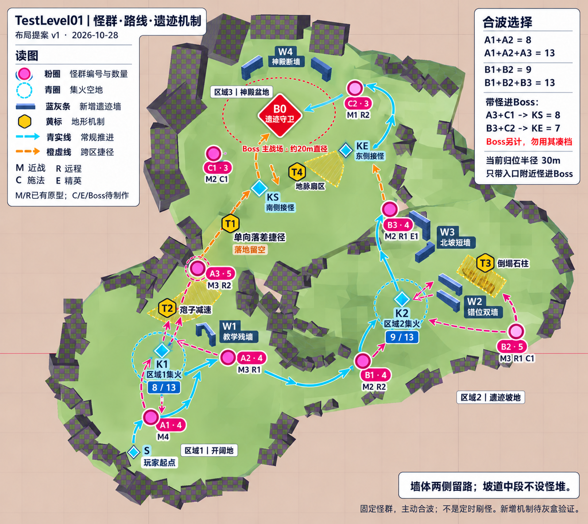

# TestLevel01：怪群、路线、遗迹墙与地形机制布局
日期：2026-10-28  
状态：**基于已确认关卡基线的布局提案 v1，供灰盒验证；具体点位、怪种配比与机制尚未冻结。**

> 实施更新（2026-10-28）：区域1的A1/A2/A3已配置为13只固定敌人，接入现有EncounterController并完成区域1导航；其余区域和机制仍属提案。编辑入口与实测记录见[TestLevel01区域1配置说明](TestLevel01-Area1-Configuration.md)。

## 1. 依据与本次范围

已确认基线来自[地图与关卡设计](../Vestiges%20of%20the%20divine/地图与关卡设计-2026-10-25.md)：一张连续地图，固定怪群点位，玩家自主规划路线与合波，开放区域之间不清仇恨、不重置战斗，允许把合法可达的小怪带进 Boss 场地。区域1在左下，区域2在右侧，区域3为中上盆地，保留蓝色方块所示起点。

先前样板建议为区域1两组近战为主、区域2两组混合怪和共享 Boss 场地。**此前没有冻结这张图的逐堆坐标与数量表**；本案在该最小样板上增加崖顶、北坡与神殿两侧的可选怪群，使地图能够验证较大的合波。图中的 8 堆、32 只小怪与全部新增内墙／机制均是本次提案，不追溯标记为既有定案。

本轮只产出图纸、配比、路线和验证条件，未向 TestLevel01.tscn 添加单位、墙体、导航或机制，也未调整现有空气墙、单位参数和场景布局。图为生成式视觉示意，保留地图拓扑与原起点；不可直接把生成图像素当成场景施工坐标。

## 2. 布局总览与战斗职责

- 区域1：认识单堆、两堆合波、近战收拢；崖顶组提供第三堆与单向落差路线。
- 区域2：混合远程、施法与精英；利用错位残墙选择接近方向和集火位置。
- 区域3：开敞 Boss 盆地，保留南侧 KS 与东侧 KE 接怪点；不把所有携带小怪都拉至正中央。

怪物功能代号：M 近战，R 远程，C 施法，E 精英。功能代号不冻结林海怪物的最终种族、美术与名称。

| 功能 | 内容职责 | 现有基础与制作状态 |
|---|---|---|
| M | 跟随、占位、承接聚怪，形成可读的前排 | 已有 GoblinWarrior 原型可用于灰盒 |
| R | 分散站位与持续输出，要求接近、聚拢或借墙换线 | 已有 GoblinArcher 原型；墙体遮挡后的主动走位必须实测 |
| C | 优先处理目标，给控制、打断或绕侧创造价值 | 本案新增内容建议；灰盒可先用 R 等量占位，不能冒充已具备施法机制 |
| E | 单个高威胁近战，制造正面预警和闪避压力 | 本案新增内容建议；可先用强化 M 占位，不能只放大模型当作完成机制 |
| B0 | 遗迹守卫 Boss，组织场地危险与阵地转换 | 占位设计，先验证混战，正式技能另行制作 |

## 3. 每一堆怪的位置与组成

下表 u/v 是**原始 5208×4642 平面图**的归一化参考坐标（左上为 0/0，右下为 1/1），用于人工定位。生成示意图的排版位置允许偏移，以下参考与场景实测优先；它们不是 Godot 世界坐标，也未经过相机投影标定。

| 编号／地标 | 区域 | 原图 u,v | 组成 | 数量 | 放置与体验目的 |
|---|---|---|---|---:|---|
| A1 入口散兵 | 1 | 0.250, 0.765 | M×4 | 4 | 起点前方第一块开地。起点到最近成员保留约8～10米安全距离，不在出生点立即开战 |
| A2 残墙哨队 | 1 | 0.360, 0.680 | M×3 + R×1 | 4 | 位于 W1 东侧，留直达与绕侧两种接近方式，连接 K1 与1—2坡道 |
| A3 崖顶守队 | 1 | 0.310, 0.530 | M×3 + R×2 | 5 | 崖顶通路前的较宽口袋，不摆在起跳边沿；用于第三堆合波或携怪下落 |
| B1 坡脚前哨 | 2 | 0.630, 0.670 | M×2 + R×2 | 4 | 1—2坡道结束后的开地，先让五人队伍展开，再进入战斗 |
| B2 东侧施法组 | 2 | 0.840, 0.585 | M×3 + R×1 + C×1 | 5 | 东侧口袋，C/R 放后侧且不贴空气墙；经 W2 两侧可带向 K2 |
| B3 北坡精英组 | 2／北向连接前 | 0.710, 0.420 | M×2 + R×1 + E×1 | 4 | 北坡入口前的宽处；远离坡道狭窄中段，服务 K2 第三堆与携怪进东门 |
| C1 西侧祭司组 | 3 | 0.340, 0.360 | M×2 + C×1 | 3 | 盆地西南侧口袋，离 T1 落地缓冲区足够远，不强制落地接怪 |
| C2 东门守卫 | 3 | 0.580, 0.230 | M×1 + R×2 | 3 | 2—3连接出口内侧偏北，保持 KE 为独立汇合空地 |
| B0 遗迹守卫 | 3 | 0.450, 0.250 | Boss×1 | 1 | 盆地中央偏北，后侧 W4 提供神殿轮廓，南、东入口不设战斗封门 |

合计 **32 只小怪：M×20、R×9、C×2、E×1，另加 Boss×1**。

单堆初始分布尽量控制在半径约2～2.5米内；近战朝向主要接近方向，后排与前排相隔约1.5～3米。不要把远程放到导航边缘、空气墙背面或不可站立的装饰物顶上。

相邻可独立处理的怪堆，中心距离先以约16～20米为目标，结合成员偏移和实际警戒范围检查；不是整图强制等距。本项目 EnemyBase 默认警戒半径为6米，因此不能只比较怪堆中心距离来判断是否会误引相邻组。

## 4. 集火位置与空间尺度

| 标记 | 原图参考 u,v | 职责 |
|---|---|---|
| K1 | 0.265, 0.670 | 区域1的主要开地，接 A1/A2，进阶时加入 A3 |
| K2 | 0.735, 0.580 | 区域2的主要开地，接 B1/B2，进阶时加入 B3 |
| KS | 0.430, 0.350 | Boss 南侧接怪点，接 T1 路线的 A3 与西侧 C1 |
| KE | 0.570, 0.310 | Boss 东侧接怪点，接北坡 B3 与东门 C2 |

K1/K2 以直径16～20米可用战斗空间为灰盒目标；Boss 核心可用空地直径约20米，另保留南侧与东侧的转换空间。圈是空间意图，不是触发范围、封锁边界或精确测量圆。

主路优先保留4～6米通行宽度。局部窄口约3.5～4米，之后立即接开地；不把窄口作为唯一的集火点，也不在斜坡中段塞怪堆。前景残墙要兼顾最近档镜头的可读性。

## 5. 路线与“波次”选择

**波次指玩家选择合并的固定怪堆，不是经过触发器就自动刷怪，不强制按编号清理。**

| 方案 | 拉怪与处理顺序 | 小怪规模 | 主要决策 |
|---|---|---:|---|
| 保守推进 | A1 单独处理，再 A2；经1—2坡道至 B1，再处理 B2/B3；从东侧进入盆地 | 每次3～5 | 学习预警与接怪，不强迫合波 |
| 区域1双堆 | A1 接入后再接 A2，回 K1 | 8 | 何时继续接怪、何时投入爆发 |
| 区域1三堆 | A1/A2 维持追击，在 A3 警戒边缘接怪后回 K1 | 13 | 三组同时压场，回到空地再展开 |
| 区域2双堆 | 接 B1，再接 B2，经 W2 一侧回 K2 | 9 | 优先处理 C，保证远程进入可覆盖的攻击范围 |
| 区域2三堆 | B1/B2 向 K2 组织，再去 B3 警戒边缘接怪即返 | 13 | 不继续沿北坡把早先怪群拖出归位范围 |
| 崖顶携怪打 Boss | A3 → T1单向下落 → KS，视能力加入 C1，再接 Boss | 5 或8 + Boss | 跃落接力、先稳定落地再合波，不顺手携带整片区域1 |
| 北坡携怪打 Boss | B3 → 2—3坡道 → KE，可加入 C2，再接 Boss | 4 或7 + Boss | 利用东侧接怪空间，不强行拖至盆地西侧 |
| 盆地双侧合波 | C1+C2 组织到适合本轮站位的 KS/KE，再接 Boss | 6 + Boss | 优先解决施法与后排，Boss危险区迫使阵地转换 |

熟练玩家可尝试 A3+C1+C2 的11只 Boss 混战，但只有在各出生点到实际战斗轨迹均通过归位检查后才视为成立，不作为初版必达路线。

旧设计稿的1～4、5～8、9～12、13+四档仅作为压力层级参照。上表只列小怪规模，Boss另列以便评估；Boss是否计入正式合波评级仍待系统口径确认。本案不承诺具体经验、装备倍率、强度翻倍或额外奖励。

## 6. 归位、跨区与遭遇生命周期

当前 EnemyBase 源场景配置归位距离30米，行为脚本按**敌人自身位置与自身出生点的水平直线距离**判断，不是玩家距怪堆中心的距离，也不是导航路径总长。

- 单位出生点到计划集火位置先以不超过约20～25米为摆位目标，给绕墙、击退、追击与阵地调整预留余量；这属于验收目标，未宣称本轮已实测达成。
- 必须检查完整追击轨迹，不能只检查最终集火点。Boss本身移动与归位范围也需同步验证。
- A3 适合带至 KS，B3 适合带至 KE；不承诺 A1/A2/B1/B2 能在现有参数下被一路拖入 Boss 中央。
- 1—2坡道以转场为主，不为凑跨区波数把大合波塞在坡道中间。若想把更远怪群带入 Boss，需要验证并调整通用追击方案，不能做“过区域线永不归位”的地图特判。
- 区域边界不清仇恨、不回血、不重生，也不因跨区直接结束会话。
- Pack 状态由现有 EncounterController 管理；本次确认其具备登记、ENGAGED/RESETTING/CLEARED与目标兜底查询，不把这些自动等同于已实现完整合波奖励或所有成员无条件联动。

合波会话沿用现有报告的建议方向：有敌群交战时开始，新的参与怪群合入；按实际参与、存活与击杀记录管理结束。短暂目标接力或 RESETTING 不宜切成两次奖励；同一敌人击杀只登记一次，脱战重拉不能反复刷参与数或奖励。具体窗口与计分逻辑仍待实施。

全清模式启动时明确登记本轮规定的怪群及 Boss；清完 Boss 但仍有规定怪群存活时不能提前结算。普通自由探索不因清掉局部区域自动结束。C1/C2为固定怪群，不是 Boss 阶段中临时刷出的增援。

## 7. 新增遗迹墙的分布

原图棋盘材质的外围方块继续作为已有布景与围挡；蓝灰色 W1～W4 是本案建议新增的**内部战术墙**。图中不增加新的封门或 Boss 围栏。

| 编号 | 位置与形态 | 战术意义 | 通行约束 |
|---|---|---|---|
| W1 教学残墙 | K1与A2之间偏侧，短L形，约4×3米占地 | 让首个远程组合出现直达／绕侧选择 | 两侧均能走；不把 A2 围成独立小房 |
| W2 错位双墙 | B2与K2之间偏东，两个错位短段 | 允许改变视线、攻击线与接近方向 | 连接口够五人队伍通过，K2仍保留完整开地 |
| W3 北坡短墙 | B3南侧偏东，一段短L形 | 北坡前先组织阵形，形成接近精英的两条支路 | 不横封坡口，不影响 B3往KE的通路 |
| W4 神殿断墙 | Boss北后侧，两个分开的遗迹段 | 表达神殿地标与侧后绕行空间 | 南、东入口常开，不在主战场中间横墙 |

W1～W3初版高度约2.5～3.5米，以实际投射物、眼高和镜头测试为准；W4可稍高但保持开口。墙体应同时匹配碰撞与导航，装饰断口不能视觉可通而实际不可通。

**放墙不等于远程怪会自动绕墙。** 本轮在 AIRangedCombatSystem.gd 中未发现直接的视线射线检测，不能据此排除其他模块提供该能力。灰盒必须核实遮挡判定、投射物墙体碰撞及无法攻击时的重新寻路。能力未成立时，W1/W2只作为实体绕行布局，不把“卡视野收拢”当作现成玩法验收结果。

## 8. 地形机制与陷阱

以下参数都是首轮灰盒建议；除了现有落差地形，均不表示已具备完整功能。

| 编号 | 位置 | 行为提案 | 设计边界 |
|---|---|---|---|
| T1 单向落差捷径 | A3通往区域3的内部悬崖 | 只允许1→3，落地留约6～8米缓冲，不直接踩进 C1/Boss 警戒 | 伙伴与追怪必须有同样合法的下落路径；落地伤害／硬直待定，不默认免伤 |
| T2 孢子减速带 | 区域1通往崖顶的侧线，避开出生点 | 半径约2.5米，双方移动速度暂降约25%，离开后约1秒消退，不叠加 | 提供绕行；不定身、不连续锁死，不把它放在唯一坡道上 |
| T3 倒塌石柱 | 区域2东侧，偏离K2中心 | 明确交互，一次性预警约1.2秒后形成约3×7米定向打击区 | 初版只做伤害／短硬直，不动态封死导航；命中阵营、归因与计分须明确，不能一键秒Boss |
| T4 神殿地脉扇区 | Boss场地局部 | 沿Boss技能管线做可预警的局部地面危险区 | 面向玩家队伍，不默认Boss技能能伤害小怪；不能同时覆盖KS、KE及全部逃生方向 |

T1如使用 NavigationLink3D，单向链接只解决寻路连接，不自动提供跳跃／下落动作。需要角色移动逻辑处理实际通过；未完成前先使用常规坡道验证携怪入场，不通过瞬移伙伴掩盖断路。[Godot NavigationLinks官方说明](https://docs.godotengine.org/en/stable/tutorials/navigation/navigation_using_navigationlinks.html)

## 9. 灰盒制作与验收顺序

1. **先做最小样板：** A1、A2、B1、B2与Boss占位；17只小怪＋Boss。C按R等量替代，先证明五人队伍、近／远程与地形空间可用。
2. **再加进阶点位：** A3、B3、C1、C2，形成完整32只小怪＋Boss。C/E逐步替换成功能单位，避免用数值占位冒充机制完成。
3. **验证内墙：** 同步碰撞、导航、射线和远程重新寻路；测试3～4米口后的队伍展开与大合波拥堵。
4. **验证两条携怪路线：** T1与常规北坡分别验证，逐个记录最大归位偏移、伙伴滞后和落地状态；调整点位优先于添加地图特殊规则。
5. **最后逐个接地形机制：** 先验证T2，再T3，T4随Boss制作；每次只增加一种压力来源，区分怪物问题与地形问题。

| 验收 | 应观察的结果 |
|---|---|
| 起点与单堆 | 起点无立即强制战斗；能够只接A1，不自动拉进A2/A3 |
| 合波选择 | 8／9／13只均是主动选择，单堆处理也可完成目标 |
| 整堆参与 | 点位全体是否能可靠交战／追击；不能只靠Pack进入ENGAGED就认定全员已跟上 |
| 归位 | 每个单位追击全过程距自身出生点留有余量，不在跨区过程中突然归位 |
| 视线与远程 | 遮挡确实影响攻击线；寻路后远程能重新攻击，不原地穿墙射击 |
| 五人队伍 | 最后排队友能跟进，转角不永久堆叠，窄口后可展开 |
| 携怪进Boss | 不封门、不清外部仇恨；KS/KE可用，危险区和小怪预警仍可读 |
| 环境机制 | 陷阱有提示和绕行；归因明确，不误把离树或重置计作成功击杀 |
| 镜头 | 最近与最远档均能看到关键预警，墙体不长期遮满战场 |
| 完成条件 | Boss死亡不掩盖未清怪群；重开／卸载不重复计数或发奖 |

## 10. 产物与实现边界

- 本文与同名 PNG 为本次设计提案；图例编号为后续人工装配的共同索引。
- 图像使用内置 imagegen，原图作为编辑参考；生成与修订提示词见同目录 TestLevel01-ImagePrompts-2026-10-28.txt。
- 本轮校验了怪物配比、组合数量、图文编号与已有源配置；**没有执行本布局的战斗、导航、归位或陷阱实机验收**。
- 后续接入应复用现有单位场景、技能／效果与遭遇体系；未授权创建另一套独立怪物、计分或地图战斗系统。
